<!--
  ╔══════════════════════════════════════════════════════════════╗
  ║  PERFIL GITHUB // J.A.R.V.I.S EDITION                        ║
  ║  1. Troque USERNAME pelo seu usuário do GitHub               ║
  ║  2. Troque "SEU NOME" em assets/banner.svg                   ║
  ║  3. Ajuste textos, links, repositórios e tecnologias         ║
  ╚══════════════════════════════════════════════════════════════╝
-->

<div align="center">



<br/>

<a href="https://github.com/thaismnzs">
  
</a>

<br/><br/>


<br/><br/>



</div>

<br/>

## `> sobre_mim.exe`

<div align="center">
<table width="100%">
<tr>
<td width="55%" valign="top">

```yaml
# ╭─────────── PERFIL DO USUÁRIO ───────────╮
usuario:     THAIS MENEZES
codinome:    thaismnzs
funcao:     Estudante de Análise e Desenvolvimento de Sistemas
localizacao: Brasil 🇧🇷
idiomas:     [Português, Inglês]
foco_atual:  Agentes de IA, APIs e Cloud
status:      ● ONLINE
# ╰─────────────────────────────────────────╯
```

</td>
<td width="45%" valign="top">

- Apaixonada por **inteligência artificial**, cybersegurança, segurança de aplicações e automação
- Construo produtos rápidos, escaláveis e bem desenhados
- Aprendendo: **arquitetura, cloud, LLMs e Pentesting**


</td>
</tr>
</table>
</div>

<br/>

## `> tech_stack --list`

<div align="center">

**Linguagens**


**Front-end**


**Back-end**


**Bancos de Dados**


**IA & Dados**


</div>

<br/>

## `> ferramentas --installed`

<div align="center">


<br/><br/>


</div>

<br/>


## `> objetivos_atuais.sh`

<div align="center">
  
</div>

<br/>


## `> contribution_snake.run`

<div align="center">

<picture>
  <source media="(prefers-color-scheme: dark)" srcset="https://raw.githubusercontent.com/thaismnzs/thaismnzs/output/github-snake-dark.svg" />
  <source media="(prefers-color-scheme: light)" srcset="https://raw.githubusercontent.com/thaismnzs/thaismnzs/output/github-snake.svg" />
  
</picture>

</div>

<br/>

## `> conectar --redes`

<div align="center">

<a href="https://linkedin.com/in/thais-menezes-dev"></a>
<a href="https://github.com/thaismnzs"></a>
<a href="mailto:thaismenezes3108@gmail.com"></a>
<a href="https://seusite.dev"></a>

</div>

<br/>

<div align="center">


<br/>

```text
┌──────────────────────────────────────────────────────┐
│  "O futuro pertence a quem constrói."                │
│  — fim da transmissão // sessão encerrada com sucesso │
└──────────────────────────────────────────────────────┘
```


</div>
